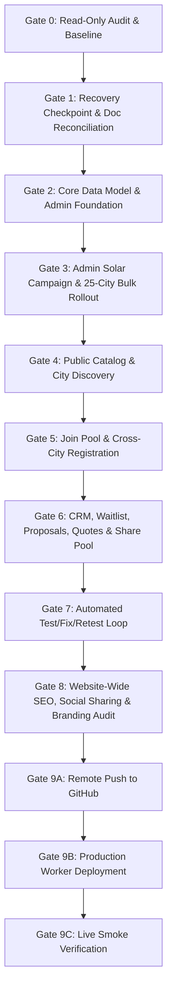

# GROUPBUYING.STORE — ORDERED IMPLEMENTATION PLAN

**Version:** 1.2.0  
**Effective Date:** 29 October 2026  
**Status:** Approved Master Phased Execution Plan  
**Target Branch:** `feat/category-agnostic-platform`  
**Production Live URL:** `https://groupbuying.store`  

---

## 1. Phased Execution Overview

---

## 2. Gate-by-Gate Roadmap & Completion Status

### Gate 0–7: Core MVP Architecture [PASSED]
- **Category-Agnostic Engine:** Implemented with dynamic categories, multi-city campaign rollout, independent city pool capacity, and FIFO waitlists.
- **Admin Console:** All modules operational (Overview, Categories, Locations, Campaigns, Members, Quotes, Blog, and Audit Logs).
- **Public Joins & Demand Proposals:** 100% free interest registration, DPDP compliance, zero customer deposits.
- **Automated Verification:** 372 automated tests passing across 102 test suites.

### Gate 8: Website-Wide SEO, Social Sharing & Branding [PASSED]
- **Canonical Domain:** Standardized to `https://groupbuying.store`.
- **Metadata Coverage:** Validated across Homepage, Category Directories, City Directories, Deals, and Blog.
- **Brand Assets:** Integrated official logo and favicon assets (`Logo.jpg` and `favicon.jpg`) with multi-platform OpenGraph previews.

### Gate 9A–9C: Production Release & Live Verification [PASSED]
- **Git Remote:** Pushed to `origin/feat/category-agnostic-platform`.
- **Worker Deployment:** Deployed to Cloudflare Workers production target `poolbuy-india` (`Version ID: df5302f5-cd8f-4ec8-a871-3593dd1979a1`).
- **Live Verification:** HTTP 200 OK verified across all key routes, assets, and APIs on `https://groupbuying.store`.
