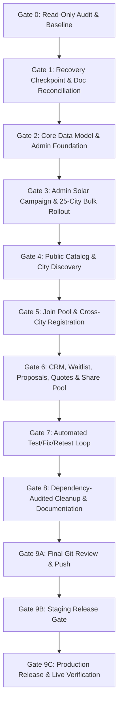

# GROUPBUYING.STORE — ORDERED IMPLEMENTATION PLAN

**Version:** 1.1.0  
**Effective Date:** 29 October 2026  
**Status:** Approved Master Phased Execution Plan  
**Target Branch:** `feat/category-agnostic-platform`

---

## 1. Phased Execution Overview

---

## 2. Gate-by-Gate Roadmap & Acceptance Criteria

### Gate 0: Read-Only Repository Audit [PASSED]
- **Objective:** Verify actual repository state, branches, uncommitted files, schema migrations, and deployment targets without mutating any files or databases.
- **Completed Baseline:**
  - Branch: `feat/category-agnostic-platform` at HEAD commit `60d91bc`.
  - Preserved 12 modified files and 4 untracked files representing Step 3 work.
  - Verified local D1 (0001-0008), staging D1 (0001-0008), and production D1 (0001-0005 applied, 0006-0008 pending).
  - Verified 10 cities currently in D1 vs. 25 `LAUNCH_CITIES` in `lib/constants.ts`.
  - Identified ESLint error in `components/admin-members-requests-tab.tsx:62`.

### Gate 1: Recovery Checkpoint & Document Reconciliation [IN PROGRESS]
- **Objective:** Create recovery checkpoint commits/tags, reconcile historical architecture (v7.3 shared-pool superseded by 1-to-N independent pools), eliminate obsolete payment instructions, and harmonize documentation.
- **Tasks:**
  1. Fix lint error in `components/admin-members-requests-tab.tsx` and commit Step 3 cleanly (`0844e76`).
  2. Create recovery branch `checkpoint/gate-0-baseline` and tag `checkpoint-gate-1-reconciliation`.
  3. Reconcile `docs/PRODUCT_CONTRACT.md`, `docs/IMPLEMENTATION_PLAN.md`, `docs/IMPLEMENTATION_PROGRESS.md`, and `CHATGPT_HANDOFF.md`.
- **Pass Criteria:** A verified recovery reference exists, product rules are consistent, and documentation accurately distinguishes historical experiments from the canonical contract.

### Gate 2: Core Data Model & Admin Foundation
- **Objective:** Verify and align core D1 tables for categories, cities, campaigns, pools, leads, waitlists, and audit logs.
- **Tasks:**
  1. Ensure all 25 canonical launch cities exist in D1 `cities` directory with proper slugs and active statuses.
  2. Align `city-delhi-ncr` / `delhi` slug mapping so queries resolve cleanly.
  3. Verify independent capacity, status, and waitlist invariants per city pool.
  4. Ensure immutable audit logging on all administrative mutations.
- **Pass Criteria:** Schema and seed verification pass; city directory contains the 25 launch cities; admin security guards active.

### Gate 3: Admin Solar Campaign & 25-City Bulk Rollout
- **Objective:** Enable Admin to create or associate a Solar campaign across the 25 launch cities in an atomic, idempotent workflow.
- **Tasks:**
  1. Campaign selection/creation using actual configured Solar category.
  2. Multi-city selector targeting the 25 verified launch cities.
  3. Pre-execution preview showing existing city pools and new city pools to create.
  4. Execution creates missing city pools without duplicating existing pools or resetting counts.
  5. Rerun idempotency test: running again makes zero duplicates.
- **Pass Criteria:** Per-city outcome returned (created, existing, skipped); independent capacities preserved; reruns idempotent.

### Gate 4: Public Catalog & City Discovery
- **Objective:** Deliver open All-India discovery and city/category filtering without forced gating or fake urgency.
- **Tasks:**
  1. Ensure All-India discovery is the primary view; city filters update catalog cleanly.
  2. Display accurate, live confirmed buyer counts, target capacity, and waitlist counts.
  3. Remove or verify authenticity of urgency badges (based strictly on real math: `remainingSpots = targetBuyers - currentBuyers`).
  4. Ensure detail pages resolve to canonical city pool records.
- **Pass Criteria:** Nationwide browsing and city filters render real pool records; zero PII rendered publicly; responsive UI intact.

### Gate 5: Join Pool & Cross-City Registration Flow
- **Objective:** Implement complete join experience including city mismatch warnings, PIN code integrity, and privacy-safe cross-city duplicate detection.
- **Tasks:**
  1. Prominently display target pool city in the join dialog.
  2. Collect/confirm user city; display explicit notice on mismatch (*"You are joining the Bhopal pool, not the Lucknow pool"*).
  3. Validate 6-digit PIN code preserving leading zero strings (`^[0-9]{6}$`).
  4. Exact pool duplicate check returns existing status idempotently.
  5. Cross-city same-category check detects existing registrations safely without revealing PII.
  6. Require explicit confirmation before allowing a new city registration; never alter previous city's count.
  7. Re-validate all conditions server-side.
- **Pass Criteria:** Full test matrix passes for repeat submissions, city mismatch, cross-city joins, and PII protection.

### Gate 6: CRM, Waitlist, Proposals, Quotes & Share Pool
- **Objective:** Harmonize CRM classifications, manual WhatsApp messaging, quotation lifecycle, and viral sharing.
- **Tasks:**
  1. Ensure strict separation of Confirmed Members, Waitlist Applicants, and Demand Proposals in UI and D1 reads.
  2. Remove historical payment templates (`PAYMENT_INSTRUCTIONS`, fee disclosures) in favor of truthful coordination messages.
  3. Verify FIFO waitlist promotion preserving `pincode` and `existing_quote`.
  4. Verify Share Pool links resolve to canonical `/deals/[citySlug]/[poolSlug]`.
- **Pass Criteria:** CRM displays live D1 data; payment templates eradicated; waitlist promotion verified.

### Gate 7: Automated Test/Fix/Retest Loop
- **Objective:** Comprehensive automated verification across unit, integration, and build suites.
- **Tasks:**
  1. Update and expand tests in `lib/__tests__/` covering independent pools, bulk rollout, city mismatch, and cross-city rules.
  2. Resolve or supersede historical `v73-shared-pool.test.ts` to reflect the 1-to-N independent pool architecture.
  3. Execute autonomous fix loops until `npm test`, `npx tsc --noEmit`, `npm run lint`, `npm run build`, and `npm run build:worker` are 100% green.
- **Pass Criteria:** All suites green; zero waived failures.

### Gate 8: Dependency-Audited Cleanup & Documentation
- **Objective:** Prune obsolete references and update documentation.
- **Tasks:**
  1. Audit dependencies and imports.
  2. Finalize `PRODUCT_CONTRACT.md`, `IMPLEMENTATION_PLAN.md`, `IMPLEMENTATION_PROGRESS.md`, and `CHATGPT_HANDOFF.md`.
- **Pass Criteria:** Zero orphaned imports, clean git diff, documentation reflects actual state.

### Gate 9A: Final Git Review & Push
- **Objective:** Final safety review of staged git diff and push to remote.
- **Pass Criteria:** Staged changes verified clean of secrets; committed and pushed to `feat/category-agnostic-platform`.

### Gate 9B: Staging Release Gate
- **Objective:** Apply migrations to staging D1 and deploy worker to `poolbuy-india-hotfix-test`.
- **Pass Criteria:** Staging deployment verified live; smoke tests pass; zero defects.

### Gate 9C: Production Release & Live Verification
- **Objective:** Review and apply migrations 0006-0008 to production D1 (`groupbuying-prod`), deploy worker to `poolbuy-india` (`groupbuying.store`), and conduct live non-destructive verification.
- **Pass Criteria:** Live production verified; smoke tests pass; handoff finalized.
