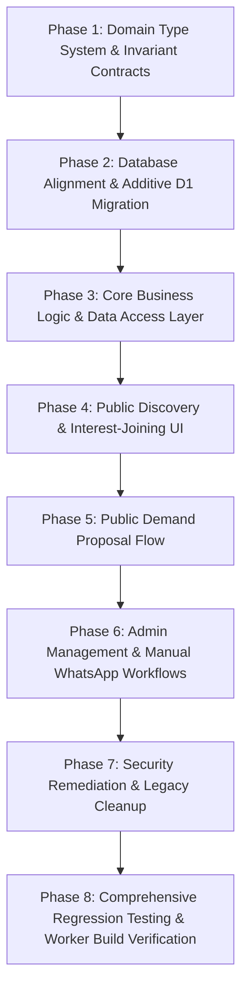

# GROUPBUYING.STORE — ORDERED IMPLEMENTATION PLAN

**Version:** 1.0.0  
**Effective Date:** 28 October 2026  
**Status:** Approved Phased Execution Roadmap  
**Target Branch:** `feat/category-agnostic-platform`

---

## Dependency Order Overview

---

## Phase 1: Domain Type System & Invariant Contracts
- **Objective:** Establish the category-agnostic domain models in [`types/index.ts`](file:///c:/Users/iamvi/poolbuy-india/types/index.ts) without hardcoded category unions.
- **Tasks:**
  1. Refactor `PoolCategory` from a rigid union to an extensible string slug, backed by dynamic `Category` entity (`id, slug, label, description, isActive, sortOrder`).
  2. Model `Pool` with explicit independent identity: `citySlug`, `categorySlug`, `productTitle`, `brand`, `model`, `variantName`, `targetBuyers`, `currentBuyers`, `maxWaitlistSize`, `status`, `deadline`.
  3. Model `PoolLead` and `PoolWaitlist` with strict status enums.
  4. Ensure zero references to hardcoded category constants in base types.
- **Acceptance Criteria:**
  - `npx tsc --noEmit` succeeds.
  - Types represent city-isolated cohorts and dynamic categories.

---

## Phase 2: Database Alignment & Additive D1 Migration
- **Objective:** Additive SQLite schema updates to support category-agnostic city pools cleanly.
- **Tasks:**
  1. Create additive migration [`migrations/d1/0004_category_agnostic_city_pools.sql`](file:///c:/Users/iamvi/poolbuy-india/migrations/d1):
     - Add `product_title TEXT` and `variant_name TEXT` to `pools` if not already present.
     - Add composite index on `pools(city_slug, category_slug, is_published, status)`.
     - Add index on `pool_requests(category_slug, status)`.
  2. Maintain existing D1 schema migrations `0001`, `0002`, `0003` completely intact.
- **Acceptance Criteria:**
  - Migrations apply cleanly in local Miniflare D1 test harness.
  - Zero data loss or modification of existing applied migrations.

---

## Phase 3: Core Business Logic & Data Access Layer
- **Objective:** Implement category-agnostic, city-isolated pool and lead operations in `lib/`.
- **Tasks:**
  1. [`lib/pools.ts`](file:///c:/Users/iamvi/poolbuy-india/lib/pools.ts): Realign queries to enforce `Pool(city_slug, slug)` isolation. Atomic SQLite capacity update: `UPDATE pools SET current_buyers = current_buyers + 1 WHERE id = ? AND current_buyers < target_buyers`.
  2. [`lib/leads.ts`](file:///c:/Users/iamvi/poolbuy-india/lib/leads.ts): Enforce idempotent join, member exclusion, and FIFO waitlist promotion.
  3. [`lib/requests.ts`](file:///c:/Users/iamvi/poolbuy-india/lib/requests.ts): Free-text proposal submission and admin conversion logic.
  4. [`lib/categories.ts`](file:///c:/Users/iamvi/poolbuy-india/lib/categories.ts) & [`lib/cities.ts`](file:///c:/Users/iamvi/poolbuy-india/lib/cities.ts): Fully dynamic D1 queries with honest fallback.
  5. [`lib/validation.ts`](file:///c:/Users/iamvi/poolbuy-india/lib/validation.ts): Update Zod schemas for join, request, and admin mutation.
- **Acceptance Criteria:**
  - Joins in City A increment City A only.
  - Duplicate joins with same mobile number return existing status without count increase.
  - Reaching target capacity triggers `TARGET_REACHED` and routes further joins to FIFO waitlist.

---

## Phase 4: Public Discovery & Interest-Joining UI
- **Objective:** Rebuild consumer pages and components for category-agnostic browsing.
- **Tasks:**
  1. [`app/page.tsx`](file:///c:/Users/iamvi/poolbuy-india/app/page.tsx): Category-agnostic hero, dynamic category grid, city switcher, active deals, and "Start a Pool" CTA.
  2. [`app/deals/[citySlug]/[poolSlug]/page.tsx`](file:///c:/Users/iamvi/poolbuy-india/app/deals/[citySlug]/[poolSlug]/page.tsx): Pool detail page with truthful capacity progress, verified quote badge (or indicative label), and join modal.
  3. [`app/category/[categorySlug]/page.tsx`](file:///c:/Users/iamvi/poolbuy-india/app/category/[categorySlug]/page.tsx) & [`app/city/[citySlug]/page.tsx`](file:///c:/Users/iamvi/poolbuy-india/app/city/[citySlug]/page.tsx): Dynamic filtered views.
  4. Components: [`components/pool-catalog.tsx`](file:///c:/Users/iamvi/poolbuy-india/components/pool-catalog.tsx), [`pool-card.tsx`](file:///c:/Users/iamvi/poolbuy-india/components/pool-card.tsx), [`join-pool-modal.tsx`](file:///c:/Users/iamvi/poolbuy-india/components/join-pool-modal.tsx), [`site-header.tsx`](file:///c:/Users/iamvi/poolbuy-india/components/site-header.tsx), [`site-footer.tsx`](file:///c:/Users/iamvi/poolbuy-india/components/site-footer.tsx).
- **Acceptance Criteria:**
  - Zero hardcoded solar-only layout or copy.
  - Real active counts rendered honestly.
  - Responsive layout verified across mobile and desktop.

---

## Phase 5: Public Demand Proposal Flow
- **Objective:** Clean, frictionless demand aggregation from anywhere in India.
- **Tasks:**
  1. [`components/pool-request-form.tsx`](file:///c:/Users/iamvi/poolbuy-india/components/pool-request-form.tsx): Simple modal capturing product need, city/town, state, contact name, and WhatsApp number.
  2. Route [`app/api/pool-requests/route.ts`](file:///c:/Users/iamvi/poolbuy-india/app/api/pool-requests/route.ts): Validation, rate limiting, and persistence into `pool_requests`.
- **Acceptance Criteria:**
  - Any valid submission is persisted with status `REQUESTED`.
  - Proposals never appear in public pool catalog until converted by Admin.

---

## Phase 6: Admin Management & Manual WhatsApp Workflows
- **Objective:** Empower operator to review requests, manage city pools, attach quotes, and communicate safely.
- **Tasks:**
  1. Generalize [`components/admin-dashboard.tsx`](file:///c:/Users/iamvi/poolbuy-india/components/admin-dashboard.tsx), [`admin-pools-tab.tsx`](file:///c:/Users/iamvi/poolbuy-india/components/admin-pools-tab.tsx), [`admin-requests-tab.tsx`](file:///c:/Users/iamvi/poolbuy-india/components/admin-requests-tab.tsx), and [`admin-leads-tab.tsx`](file:///c:/Users/iamvi/poolbuy-india/components/admin-leads-tab.tsx).
  2. Implement request review & conversion workflow (Admin selects category & city & creates official pool).
  3. Implement member management (exclusion, FIFO promotion).
  4. WhatsApp manual workflow: generate `wa.me` links with honest templates; log clicks to audit trail; enforce `do_not_contact = 1`.
- **Acceptance Criteria:**
  - All admin routes protected by HMAC session cookie.
  - Operator mutations recorded in `admin_audit_logs`.

---

## Phase 7: Security Remediation & Legacy Cleanup
- **Objective:** Eliminate tracked credentials and prune obsolete legacy code.
- **Tasks:**
  1. Sanitize or excise the 5 credential-bearing verification scripts in `scratch/` and `scripts/e2e-verification.mjs`.
  2. Remove `@supabase/supabase-js` and `cloudflare` from `package.json`.
  3. Remove legacy directories `lib/supabase/` and `supabase/`.
  4. Remove obsolete `lib/products.ts` (hardcoded `STANDARD_PRODUCTS`).
- **Acceptance Criteria:**
  - Zero hardcoded secrets in tracked Git files.
  - `npm ls` clean, zero dead dependencies.

---

## Phase 8: Comprehensive Regression Testing & Worker Build Verification
- **Objective:** End-to-end automated verification.
- **Tasks:**
  1. Implement automated test suites in `lib/__tests__/` covering independent city pools, duplicate joins, full capacity 409, FIFO waitlist promotion, admin permissions, and quotation audit.
  2. Execute `npm run test`, `npx tsc --noEmit`, `npm run lint`.
  3. Execute `npm run build` and `npm run build:worker`.
- **Acceptance Criteria:**
  - 100% test pass rate.
  - OpenNext worker compiled to `.open-next/worker.js`.

